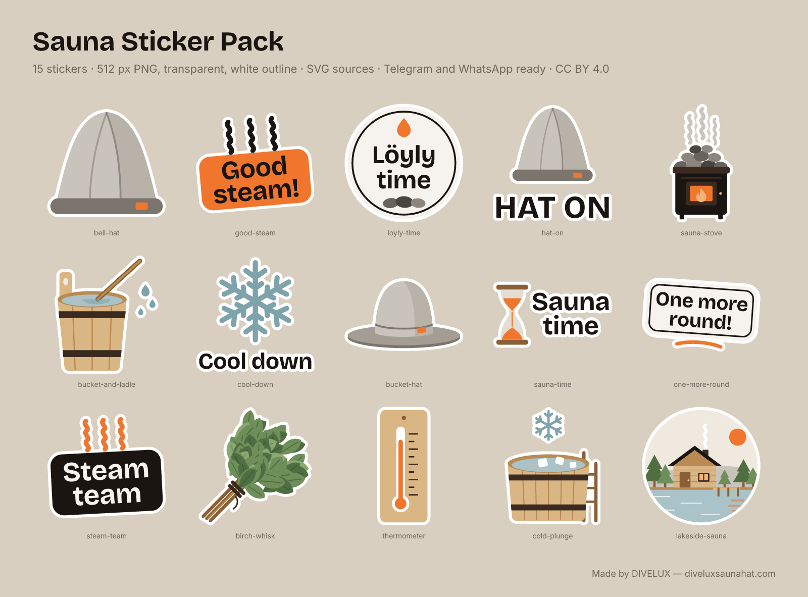

# Sauna Sticker Pack

15 stickers for sauna people: wool sauna hats, a stove, a bucket and ladle, a birch whisk, a cold plunge, and a few words you actually say at the sauna door: "Good steam!", "Löyly time", "Hat on", "One more round!", "Cool down".

Made by DIVELUX, makers of handmade wool sauna hats — https://diveluxsaunahat.com

## What is inside

| Path | What it is |
|---|---|
| `png/` | 15 stickers, 512 x 512 PNG, transparent background, white outline (Telegram format) |
| `whatsapp/` | the same stickers as 512 x 512 WebP under 100 KB each, plus `tray-icon.png` (96 x 96) |
| `svg/` | vector sources, 512 x 512; lettering is converted to paths, the white outline is a real path |
| `telegram-icon-100.png` | optional pack icon for Telegram |
| `preview.png`, `preview-dark.png` | contact sheets |
| `src/build.py` | the script that draws the stickers and traces the outline |
| `LICENSE` | CC BY 4.0 for the artwork, MIT for the script |

## Stickers and suggested emoji

| File | Sticker | Emoji |
|---|---|---|
| `bell-hat` | Bell sauna hat | 🧢 |
| `good-steam` | "Good steam!" | 👍 |
| `loyly-time` | "Löyly time" | 💦 |
| `hat-on` | "Hat on" | 🎩 |
| `sauna-stove` | Sauna stove | 🔥 |
| `bucket-and-ladle` | Bucket and ladle | 🪣 |
| `cool-down` | "Cool down" | ❄️ |
| `bucket-hat` | Bucket sauna hat | 👒 |
| `sauna-time` | "Sauna time" | ⏳ |
| `one-more-round` | "One more round!" | 🔁 |
| `steam-team` | "Steam team" | 🤝 |
| `birch-whisk` | Birch whisk | 🌿 |
| `thermometer` | Thermometer | 🌡️ |
| `cold-plunge` | Cold plunge | 🥶 |
| `lakeside-sauna` | Sauna by the lake | 🏡 |

Löyly is the Finnish word for the steam that rises when water hits the hot stones.

## Add the pack to Telegram

Telegram takes static stickers as PNG or WebP with one side exactly 512 px, the other side 512 px or less, and a transparent background. The files in `png/` already match that.

1. In Telegram, open a chat with the official bot **@Stickers** and press Start.
2. Send `/newpack` and type a name for the pack, for example `Sauna Stickers`.
3. Send the first image from `png/` **as a file** (on a phone: the paperclip, then "File"; on desktop: drag it in and untick "Compress"). A photo upload gets compressed and is rejected.
4. Send one emoji that fits the sticker (see the table above).
5. Repeat steps 3 and 4 for the other stickers.
6. Send `/publish`. When the bot asks for an icon, send `telegram-icon-100.png` as a file or send `/skip`.
7. Choose a short name for the link, for example `sauna_stickers_yourname`. The bot replies with a link of the form `https://t.me/addstickers/<short name>`. Open it and press "Add Stickers".

The bot's wording changes from time to time; follow its prompts if a step looks different.

## Add the stickers to WhatsApp

WhatsApp has no "import a folder" button, so there are two ways:

- **One by one, inside WhatsApp:** in current versions of WhatsApp, open a chat, open the sticker panel, choose "Create" and pick an image from `png/`. WhatsApp saves it to your stickers. This is the quickest way to add a few favorites.
- **As a pack, with a sticker maker app:** WhatsApp sticker packs are built by third-party "sticker maker" apps. Create a new pack in such an app, add the files from `whatsapp/` (512 x 512 WebP, under 100 KB each, 16 px clear margin), use `tray-icon.png` as the tray icon, then tap "Add to WhatsApp". A pack needs at least 3 stickers and holds up to 30.

## License and credit

Free to use and share under [CC BY 4.0](https://creativecommons.org/licenses/by/4.0/). If you republish the pack, please credit:

> Stickers by DIVELUX — diveluxsaunahat.com

More free sauna tools: https://diveluxsaunahat.com/pages/sauna-tools
